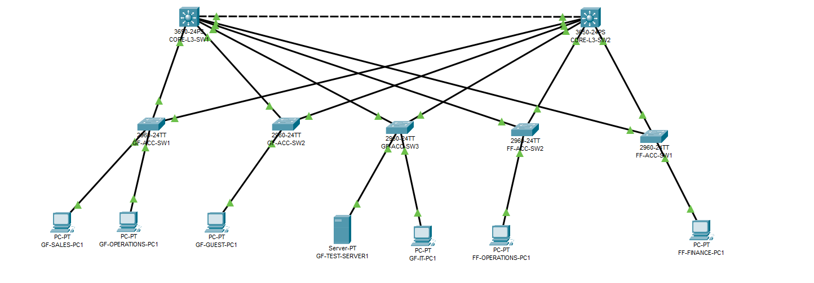

# Project 01 — Small Business Network Design and Implementation

**Network Design | VLAN Segmentation | Inter-VLAN Routing | HSRP | ACL Security | Troubleshooting**

**Project:** Northstar Business Solutions  
**Environment:** Cisco Packet Tracer (Simulated Lab)  
**Status:** Core Network Implemented — Further Resilience Testing Pending

---

## 1. Project Overview

This project demonstrates the design, implementation, verification and troubleshooting of a segmented small-business network for a fictional organisation.

Northstar Business Solutions requires a network capable of supporting approximately 60 employees across two office floors, with provision for future growth.

The implementation follows a structured network engineering approach, beginning with business requirements and progressing through network design, a Method of Procedure (MOP), configuration, verification and troubleshooting.

The project is independently developed and uses Cisco Packet Tracer to simulate the network environment.

## 2. Network Topology

The simulated topology consists of:

- Two Cisco Catalyst 3650 Layer 3 core switches.
- Five Cisco Catalyst 2960 access switches.
- Eleven documented inter-switch connections.
- Ground-floor and first-floor network segments.
- Workstations representing different departments.
- A test server for connectivity verification.
- Redundant connections between the access and core layers.

The physical connections and switch interfaces are documented using Cisco Discovery Protocol (CDP).

### Packet Tracer Simulation

[Open the Project 01 Packet Tracer file (.pkt)](Northstar-Project01-HSRP-Failover-Recovered-v12.pkt)

Download the file from GitHub and open it using Cisco Packet Tracer to explore the implemented network configuration.

**Simulation Status:** Core network functionality implemented and tested. Full resilience validation remains outstanding.

## 3. Network Architecture

The network uses nine VLANs to separate departments and infrastructure services.

| VLAN | Name | Network |
|---|---|---|
| 10 | SALES | 192.168.10.0/27 |
| 20 | OPERATIONS | 192.168.20.0/26 |
| 30 | FINANCE | 192.168.30.0/27 |
| 40 | IT | 192.168.40.0/28 |
| 50 | SERVERS | 192.168.50.0/27 |
| 60 | VOICE | 192.168.60.0/26 |
| 70 | CCTV | 192.168.70.0/28 |
| 80 | GUEST | 192.168.80.0/27 |
| 90 | MANAGEMENT | 192.168.90.0/27 |

Layer 3 switching and Switch Virtual Interfaces (SVIs) provide routing between permitted internal VLANs.

802.1Q trunk connections carry multiple VLANs between the core and access switches.

Spanning Tree Protocol (STP) is used to prevent Layer 2 switching loops and manage redundant forwarding paths.

## 4. Implemented Technologies

The following technologies and configurations were implemented and tested within the scope of the simulated lab:

- VLAN creation and departmental network segmentation.
- 802.1Q trunk configuration.
- Access-port configuration and shutdown of unused ports.
- STP root bridge selection and forwarding-path verification for selected VLANs.
- SVI configuration and inter-VLAN routing.
- HSRP gateway redundancy for VLANs 10 and 20.
- Extended IP ACLs for Sales-to-Finance restrictions.
- Guest VLAN isolation from defined internal networks.
- Routing, switching and connectivity verification using Cisco IOS commands.
- Controlled HSRP failover, recovery and troubleshooting.

## 5. Network Security

Two principal security policies were implemented:

**Sales-to-Finance restriction:** Workstations in VLAN 10 are prevented from accessing the Finance subnet in VLAN 30, while permitted communication such as Sales-to-Server remains available.

**Guest isolation:** Devices in VLAN 80 are restricted from accessing the eight other defined internal VLAN subnets.

The ACLs were configured on both Layer 3 core switches.

Testing verified selected permitted and blocked traffic, including Guest-to-Finance restrictions through both core switches.

These tests validate the documented traffic scenarios rather than every possible protocol, route or security condition.

## 6. HSRP Failover and Troubleshooting

HSRP was configured for VLANs 10 and 20 to provide first-hop gateway redundancy.

During a controlled VLAN 10 failover test:

1. CORE-L3-SW1's VLAN 10 SVI was administratively shut down.
2. CORE-L3-SW2 successfully transitioned to the Active HSRP role.
3. Sales-to-Server connectivity initially failed.
4. Investigation identified that CORE-L3-SW1 had lost its directly connected route to the Sales subnet.
5. Changing the server's default gateway temporarily to CORE-L3-SW2 was followed by successful connectivity.
6. CORE-L3-SW1's VLAN 10 interface and the server's original gateway were restored.
7. Final connectivity and Sales-to-Finance ACL tests passed.

The results were consistent with a return-path routing issue, although the exact contribution of routing behaviour and convergence delays was not conclusively isolated.

**Key lesson:** Successful HSRP role failover does not automatically guarantee end-to-end network availability. Both forward and return routing paths must remain operational.

A permanent resilient return-path solution remains outstanding.

## 7. Project Documentation

The technical documentation is organised as follows:

| Document | Description |
|---|---|
| [01 — Requirements](01-Requirements.md) | Business requirements, network objectives and constraints |
| [02 — Network Design](02-Network-Design.md) | Network architecture, VLANs, IP addressing and design decisions |
| [03 — Physical Port Mapping](03-Physical-Port-Mapping.md) | Verified switch connections and interface mapping |
| [04 — Method of Procedure](04-Method-of-Procedure.md) | Planned implementation steps, verification and rollback procedures |
| [05 — Implementation and Verification](05-Implementation-and-Verification.md) | Configuration results, testing, troubleshooting and lessons learned |

## 8. Technical Evidence

The project includes 34 screenshots documenting the simulated implementation and testing.

Selected evidence:

- [Final Network Topology](evidence/01-final-network-topology.png)
- [CORE-L3-SW1 VLAN Verification](evidence/02-core-sw1-vlan-table.png)
- [CORE-L3-SW2 VLAN Verification](evidence/03-core-sw2-vlan-table.png)
- [CORE-L3-SW1 Trunk Verification](evidence/09-core-sw1-trunk-status.png)
- [CORE-L3-SW1 STP Verification](evidence/11-core-sw1-stp-vlan10.png)
- [CORE-L3-SW1 HSRP Status](evidence/19-core-sw1-hsrp-status.png)
- [HSRP Failover Takeover](evidence/30-core-sw2-vlan10-hsrp-takeover.png)
- [Connectivity Restored During Troubleshooting](evidence/31-sales-server-connectivity-restored.png)
- [HSRP Recovery Verification](evidence/32-core-sw1-hsrp-recovered.png)
- [Final Post-Failover Verification](evidence/34-sales-gateway-final-stability.png)

[View the complete evidence folder](evidence/)

## 9. Outstanding Work

The core network has been implemented and verified for the documented scenarios. However, further work is required to complete the broader design:

- Configure additional gateway redundancy where required.
- Resolve and validate resilient return-path routing during gateway failover.
- Perform controlled physical uplink and core-switch failure tests.
- Measure packet loss and recovery times during failover.
- Verify ACL enforcement under additional failure conditions.
- Complete STP validation across all required VLANs.
- Connect and test Voice and CCTV endpoints.
- Review network management security and additional hardening.
- Implement and test upstream firewall and internet connectivity.

These items are documented as outstanding rather than presented as completed functionality.

## 10. Skills Demonstrated

This project demonstrates practical experience in:

- Network requirements analysis and design.
- IP addressing and subnetting.
- VLAN segmentation and Layer 2 switching.
- Inter-VLAN routing using Layer 3 switches.
- First-hop gateway redundancy.
- Network access control and security testing.
- Cisco IOS operational verification.
- Structured troubleshooting and fault isolation.
- Change planning, documentation and rollback.
- Evidence-based technical reporting.

## 11. Project Disclaimer

This is an independently developed educational network engineering project.

Northstar Business Solutions is a fictional organisation, and all network infrastructure has been simulated in Cisco Packet Tracer.

The implementation is not presented as a production deployment or as a fully validated high-availability solution.
