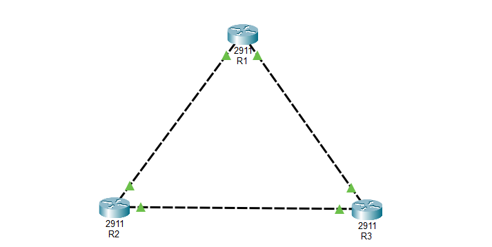

# Project 02 — OSPF Routing & Network Troubleshooting

**Cisco Packet Tracer | CCNA | Routing & Switching | Service Provider Fundamentals**

## Project Overview

This project simulates the internal routing network of **NorthLink Networks**, a fictional Internet Service Provider operating three Points of Presence (PoPs).

The objective is to configure and verify OSPFv2 routing across a three-router backbone, investigate simulated network incidents, and demonstrate structured troubleshooting, fault isolation and recovery procedures.

The lab was developed to strengthen practical networking skills relevant to Junior Network Engineer positions.

## Network Topology



The network consists of three Cisco 2911 routers connected in a triangular topology using /30 point-to-point networks.

All three routers participate in **OSPF Area 0**, providing alternative routing paths between the PoPs.

## Technologies Demonstrated

- IPv4 addressing and /30 subnetting
- Cisco IOS router configuration
- OSPFv2 single-area routing
- OSPF neighbour establishment and verification
- Routing-table analysis
- Equal-Cost Multi-Path (ECMP) route verification
- Network connectivity testing
- Troubleshooting, incident recovery and documentation

## Troubleshooting Scenarios

### Incident 01 — OSPF Link Failure and Recovery

**Status: Resolved**

A controlled R1–R2 link failure was simulated by shutting down R1's GigabitEthernet0/0 interface.

OSPF removed the unavailable next hop while retaining an alternative route through R3.

Successful connectivity tests confirmed reachability to R2 through the surviving network. The original OSPF adjacencies and equal-cost routes were restored following recovery.

**Evidence:**

- [Baseline OSPF routes](evidence/incident-01/01-Baseline-OSPF-Routes.png)
- [Simulated link failure](evidence/incident-01/02-R1-R2-Link-Failure.png)
- [OSPF neighbour loss](evidence/incident-01/03-OSPF-Neighbour-Loss.png)
- [Alternative OSPF route](evidence/incident-01/04-OSPF-Alternative-Route.png)
- [Connectivity during failure](evidence/incident-01/05-Connectivity-During-Failure.png)
- [ECMP routes restored](evidence/incident-01/06-ECMP-Routes-Restored.png)
- [Post-recovery connectivity](evidence/incident-01/07-Post-Recovery-Connectivity.png)

### Incident 02 — OSPF Area Mismatch

**Status: Resolved**

An OSPF area mismatch was introduced by changing R2's GigabitEthernet0/0 interface from Area 0 to Area 1.

The physical connection remained operational, but the OSPF adjacency failed. Cisco IOS reported an area mismatch error.

The interface was restored to Area 0, after which FULL neighbour adjacencies, expected routes and IP connectivity were verified.

**Evidence:**

- [OSPF area mismatch](evidence/incident-02/01-OSPF-Area-Mismatch.png)
- [OSPF area restored](evidence/incident-02/02-OSPF-Area-Restored.png)

### Incident 03 — OSPF Cost and Route Selection

**Status: Resolved**

A controlled OSPF metric change was introduced by increasing R1's GigabitEthernet0/0 interface cost from 1 to 10.

Before the change, R1 had two equal-cost routes to 10.0.23.0/30 through R2 and R3. Following the change, R1 selected only the lower-cost route through R3 while maintaining IP connectivity.

The original OSPF cost was restored, both equal-cost routes returned, and post-recovery connectivity tests passed.

**Evidence:**

- [Baseline ECMP routes](evidence/incident-03/01-Incident03-Baseline-ECMP-Routes.png)
- [OSPF cost increased](evidence/incident-03/02-Incident03-OSPF-Cost-Increased.png)
- [Lower-cost route selected](evidence/incident-03/03-Incident03-Lower-Cost-Route-Selected.png)
- [Connectivity after cost change](evidence/incident-03/04-Incident03-Connectivity-After-Cost-Change.png)
- [OSPF cost restored](evidence/incident-03/05-Incident03-OSPF-Cost-Restored.png)
- [ECMP routes restored](evidence/incident-03/06-Incident03-ECMP-Routes-Restored.png)
- [Post-recovery connectivity](evidence/incident-03/07-Incident03-Post-Recovery-Connectivity.png)


## Technical Documentation

- [Network Requirements](docs/01-Network-Requirements.md)
- [Network Design and IP Addressing](docs/02-Network-Design.md)
- [Troubleshooting Report](docs/03-Troubleshooting-Report.md)

## Packet Tracer Simulation Files

- [Recovered OSPF Baseline](NorthLink-Project02-OSPF-Baseline-Recovered.pkt)
- [Incident 02 — Recovered Working Configuration](NorthLink-Project02-Incident-02-Working.pkt)
- [Incident 03 — Recovered Working Configuration](NorthLink-Project02-Incident-03-Working.pkt)
  
These files allow the simulated topology and router configurations to be inspected in Cisco Packet Tracer.

## Verification Commands

```cisco
show ip interface brief
show cdp neighbors
show ip protocols
show ip ospf interface
show ip ospf neighbor
show ip route
show ip route ospf
ping
```

## Key Lessons Learned

- A physical interface can remain up/up while OSPF fails because of a configuration mismatch.
- OSPF can retain an alternative route when a direct inter-router link fails.
- FULL OSPF adjacency, valid routing-table entries and successful connectivity are separate verification requirements.
- Structured pre-change and post-change checks help validate network changes.
- Technical documentation should reflect observed results, including simulation limitations.

## Project Limitations

This is a simulated training environment, not a production-ready ISP backbone.

OSPF convergence time, uninterrupted customer traffic and ECMP traffic distribution were not measured. During a separate Hello timer mismatch experiment, Packet Tracer continued reporting FULL adjacencies, so no adjacency failure was claimed for that experiment.

## Project Status

**Completed — 3/3 planned troubleshooting incidents resolved and documented.**
