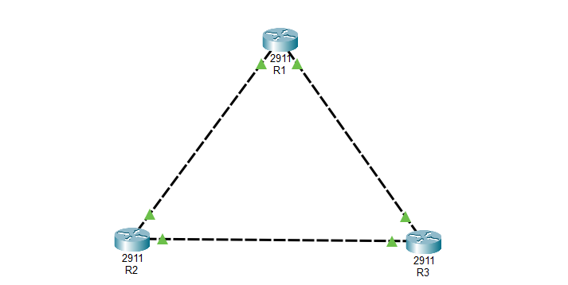

# Project 02 — Network Design

**Project:** OSPF Routing, Connectivity & Incident Troubleshooting  
**Organisation:** NorthLink Networks (Fictional)  
**Environment:** Cisco Packet Tracer  
**Network Type:** Simulated Service Provider Internal Routing Network

---

## 1. Network Overview

NorthLink Networks operates a simulated three-router network representing three regional Points of Presence (PoPs).

The network uses a triangular topology with three point-to-point Ethernet connections.

Single-area OSPFv2 provides dynamic routing between the routers and allows alternative routes to remain available when a link fails.

This is a simplified training topology designed to demonstrate CCNA-level routing, verification and troubleshooting skills.

## 2. Logical Topology


### Network Devices

| Device | Model | Role | OSPF Router ID |
|---|---|---|---|
| R1 | Cisco 2911 | PoP A Router | 1.1.1.1 |
| R2 | Cisco 2911 | PoP B Router | 2.2.2.2 |
| R3 | Cisco 2911 | PoP C Router | 3.3.3.3 |

## 3. Physical Interface Mapping

The router-to-router connections were verified using Cisco Discovery Protocol (CDP).

| Local Device | Local Interface | Remote Device | Remote Interface |
|---|---|---|---|
| R1 | GigabitEthernet0/0 | R2 | GigabitEthernet0/0 |
| R1 | GigabitEthernet0/1 | R3 | GigabitEthernet0/0 |
| R2 | GigabitEthernet0/1 | R3 | GigabitEthernet0/1 |

All three connections use Ethernet interfaces. Unused GigabitEthernet0/2 interfaces remain administratively disabled.

## 4. IPv4 Addressing Plan

All router-to-router links use /30 IPv4 subnets with a subnet mask of 255.255.255.252.

| Router | Interface | IPv4 Address | Subnet |
|---|---|---|---|
| R1 | G0/0 | 10.0.12.1 | 10.0.12.0/30 |
| R2 | G0/0 | 10.0.12.2 | 10.0.12.0/30 |
| R1 | G0/1 | 10.0.13.1 | 10.0.13.0/30 |
| R3 | G0/0 | 10.0.13.2 | 10.0.13.0/30 |
| R2 | G0/1 | 10.0.23.1 | 10.0.23.0/30 |
| R3 | G0/1 | 10.0.23.2 | 10.0.23.0/30 |

### Subnet Summary

| Link | Network Address | Broadcast Address |
|---|---|---|
| R1–R2 | 10.0.12.0 | 10.0.12.3 |
| R1–R3 | 10.0.13.0 | 10.0.13.3 |
| R2–R3 | 10.0.23.0 | 10.0.23.3 |

The /30 addressing scheme provides two usable addresses per link.

## 5. OSPF Routing Design

### OSPF Parameters

| Parameter | Configuration |
|---|---|
| Routing protocol | OSPFv2 |
| Process ID | 1 |
| Area | 0 |
| R1 Router ID | 1.1.1.1 |
| R2 Router ID | 2.2.2.2 |
| R3 Router ID | 3.3.3.3 |

### R1 OSPF Configuration

```cisco
router ospf 1
 router-id 1.1.1.1
 network 10.0.12.0 0.0.0.3 area 0
 network 10.0.13.0 0.0.0.3 area 0
```

### R2 OSPF Configuration

```cisco
router ospf 1
 router-id 2.2.2.2
 network 10.0.12.0 0.0.0.3 area 0
 network 10.0.23.0 0.0.0.3 area 0
```

### R3 OSPF Configuration

```cisco
router ospf 1
 router-id 3.3.3.3
 network 10.0.13.0 0.0.0.3 area 0
 network 10.0.23.0 0.0.0.3 area 0
```

The OSPF process IDs are locally significant. All routers participate in Area 0, and each has a unique router ID.

## 6. Routing and Redundancy

The triangular topology provides alternative paths between the routers.

Before the simulated link failure, R1 learned the remote network 10.0.23.0/30 through OSPF with two equal-cost next hops:

- 10.0.12.2 via R2
- 10.0.13.2 via R3

Both routes had an administrative distance of 110 and an OSPF cost of 2.

During the controlled R1–R2 link failure, R1 retained the route through R3.

After recovery, both equal-cost routes returned to R1's routing table.

## 7. Verification Commands

The following Cisco IOS commands were used during implementation and testing:

```cisco
show ip interface brief
show interfaces description
show cdp neighbors
show ip protocols
show ip ospf neighbor
show ip route
show ip route ospf
ping
```

These commands supported physical interface verification, OSPF neighbour validation, route inspection and connectivity testing.

## 8. Design Limitations

- The topology represents a simplified Service Provider internal routing network.
- Only single-area OSPFv2 is implemented.
- No customer networks, BGP sessions or MPLS services are configured.
- Redundancy testing is limited to a controlled single-link failure.
- OSPF convergence time and packet loss during reconvergence were not measured.
- ECMP forwarding distribution was not measured.
- Production monitoring, security hardening and high-availability services are outside the scope.

## 9. Related Documentation

- [Network Requirements](01-Network-Requirements.md)
- [Troubleshooting Report](03-Troubleshooting-Report.md)

Incident verification screenshots are stored in the `evidence/incident-01` folder at the project root.

---

**Project status:** Core OSPF implementation and Incident 01 verification completed. Additional troubleshooting scenarios pending.